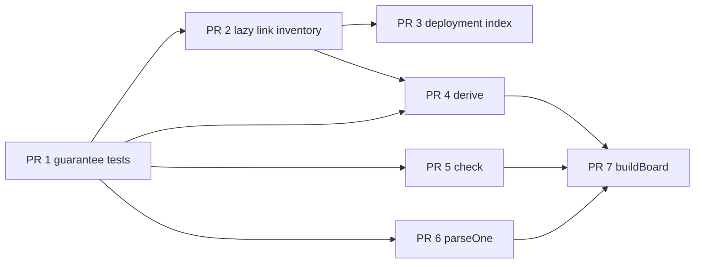

# CC Ceiling and check() Big-O Refactor Plan

> **For agentic workers:** REQUIRED SUB-SKILL: Use superpowers:subagent-driven-development (recommended) or superpowers:executing-plans to implement this plan task-by-task. Steps use checkbox (`- [ ]`) syntax for tracking.
> Nothing in this plan runs until Brandon approves it.

**Goal:** Bring the five functions over the CC 30 hard ceiling under the P0 budget (CC 8 or less, CRAP 10 or less per piece) and make `check()` close to linear, so the edit loop meets its 250 ms budget at 130 kB.

**Architecture:** Behavior is pinned by characterization tests first.
Then the two Big-O fixes ship, because they are the user-visible win.
Then each over-ceiling function is split into pure, single-purpose pieces in the file it already lives in, smallest and safest first, `buildBoard` last.

**Tech Stack:** Plain CommonJS in `lib/`, Node's built-in test runner, `scripts/bench.js`, ESLint 9 and c8 10 through `npx` (no new dependency).

**Source of the targets:** PR #44 ("Worst offenders") and the budget blocks in the five files.

## Global Constraints

- No PR changes what `parse`, `check`, `render`, `linkMap` or `sourceRanges` return for any model, except where a step names the change and Brandon approves it.
- `lib/` stays pure: no file system or network access, no new runtime dependency.
- Splits follow the shared architecture policy: each piece is a pure decider (model or evidence in, findings or boxes out), grouped by the rule or diagram it serves, with no new layer, class, registry or file unless a step says so.
- A shared helper is extracted only when two pieces already need it.
- Every new or changed function carries a budget block (PERFORMANCE-STANDARDS.md, "Annotation format").
  Values in this plan are **targets**; a block says "measured" only for a number a tool produced in that PR.
- Every PR that touches `lib/` runs `node scripts/build-site.js` and commits the rebuilt bundle; files that differ only in line endings are restored, not committed.
- Every PR that touches a P0 function puts `node scripts/bench.js` tables from before and after (three runs each) in its description.
- Every PR keeps `npm test` green, and the guarantee tests from PR 1 pass unchanged unless a step says they change.

## How each number is measured

| Value | Command |
|---|---|
| CC per function | `npx -y eslint@9 --no-config-lookup --rule '{"complexity":["warn",0]}' <files>` |
| Branch coverage | `npx -y c8@10 --reporter=json node --test "test/**/*.test.js"`, attributed to the innermost function by source range as in PR #42 |
| CRAP | CC² × (1 − cov)³ + CC, from the two values above |
| Time | `node scripts/bench.js`, three runs, quoted as a range |

The per-function attribution script from PR #42 is not in the repo; see Open questions.

## Baseline (main at d2abfe0, three bench runs, Node 22 on WSL2)

| Scale | parse ms | check ms | board ms | loop ms |
|---|---|---|---|---|
| 1x (2.7 kB) | 0.8 to 3.9 | 1.2 to 4.0 | 0.7 to 2.8 | 1.1 to 2.6 |
| 10x (27 kB) | 1.9 to 5.8 | 42 to 104 | 10 to 46 | 45 to 98 |
| 50x (135 kB) | 7.5 to 17 | 4066 to 5244 | 130 to 153 | 3939 to 4541 |

The first run was cold and noisy; the other two match the Audit table in PERFORMANCE-STANDARDS.md.

Where the time goes at 50x (one run, builders called directly on a parsed model):

| Builder | ms |
|---|---|
| `deployment` | 3999 |
| `buildBoard` | 123 |
| `context`, `containers`, `dataflow`, `contextMap` together | 4 |

A scratch run with `linkIssues` stubbed to return nothing put `check` at 0.3 ms (1x), 0.4 ms (10x) and 2.6 ms (50x).
So `linkIssues` is nearly all of `check`, and `deployment` is nearly all of `linkIssues`.

## Targets at a glance

| Target | Today (measured) | After (target) |
|---|---|---|
| `check` in `lib/rules/core.js` | CC 65, cov 96%, CRAP 65.4, O(c² + L) | coordinator CC 1, 17 pieces CC 8 or less, CRAP 10 or less, O(model) |
| `parseOne` in `lib/parser.js` | CC 41, cov 98%, CRAP 41.0, O(n + d²) per parse | dispatcher CC 3, pieces CC 5 or less, O(n) |
| `derive` in `lib/diagram/links.js` | CC 35, cov 93%, CRAP 35.5 | dispatcher CC 2, 6 pieces CC 7 or less |
| `buildBoard` in `lib/diagram/board.js` | CC 35, cov 98%, CRAP 35.0, O(E² + …) | coordinator CC 2, phases CC 8 or less, edges O(E) |
| policy-rule callback in `buildBoard` | CC 31, cov 98%, CRAP 31.0 | callback CC 3, 6 helpers CC 5 or less |
| `deployment` / `emitsOf` in `lib/diagram/system.js` | O(g·b·(v·s + w·t)·c), 4 s at 135 kB | O(c·β·m + g·(b + v·s·k + w·t·k)), k = boundaries feeding one event |
| `linkIssues` / `inventory` in `lib/diagram/links.js` | all six diagrams on every `check()` | nothing built without `@link`; only diagrams an `@link` names otherwise |

With CC 8 and branch coverage 90%, CRAP is 8.06; every piece below lands at or under that as long as its coverage stays at 90% or more.

---

## PR 1: Guarantee tests (test only, no source change)

Pin today's behavior so every later PR proves it changed nothing.

**Files:** create `test/guarantee.test.js` and `test/fixtures/guarantee/` (golden JSON).

- [ ] **Step 1: check goldens.** For every `examples/*.dsl` and each profile (`core`, `workshop`, `eventmodeling`, `slicerm`), store the full `check()` output in order.
  Order is pinned on purpose: the `check` split must keep the order findings are pushed in.
- [ ] **Step 2: link goldens.** Add one fixture model that carries `@link` on a command, a read model, a named policy and a boundary, including each bad form `linkIssues` reports (bad url, no target, unknown diagram, undrawable diagram, unknown node).
  Store its `check()` output, `linkMap()` and `sourceRanges()` for all six kinds.
- [ ] **Step 3: diagram goldens.** For every example and the link fixture, store `buildBoard()` and each `BUILDERS[kind]()` result (or the error code `NO_REGIONS` / `NO_CONTEXTS`).
  Edge order is pinned, since `deployment` feeder edges must keep boundary order.
- [ ] **Step 4: parser goldens.** One table test with every statement form `parseOne` accepts (context, system, `policy Name =`, `event name { }`, scenario, actor, boundary, view, readmodel, `readmodel from [`, `every`, `cron`, `actor -> command()`, `event -> worker`, `event {`, guard, `@`, `event from [`, `from [`) and every `ParseError` message it throws, each with its line.
  Store the parsed model as JSON.
- [ ] **Step 5: coverage gaps the Big-O PRs touch.** Raise `inventory` (71% today) and the `deployment` per-region callback (83%) to 90% or more: a model with no regions and no contexts, a boundary with `@cost(regions=1)` in a three-region system, a model with no `in Boundary(key)` (unscoped fallback edges), a worker fed by a boundary, a read model fed by two boundaries.
- [ ] **Step 6:** `npm test` green; record the new test count in the PR.

Goldens are regenerated only by an explicit `UPDATE_GOLDENS=1 node --test test/guarantee.test.js`, and a PR that regenerates one says why.

**Risk:** goldens that are too broad turn every later diff into noise.
Keep them to return values, never SVG text.

**Estimate:** p50 40 min, p90 75 min agent wall-clock to PR-ready; CI about 30 s.
Main risk: finding which inputs reach the uncovered branches.

## PR 2: Skip the diagram inventory in `check()` unless an `@link` needs it

The user-visible win: `check` at 135 kB goes from about 4 s to about 3 ms for any model with no `@link`.

**Files:** `lib/diagram/links.js`.

- [ ] **Step 1:** Split `elements` into `linkables(model)` (what, line, links; no boxes) and the existing box lookup.
  `linkIssues` only reads `what`, `line` and `links`, so it never needs the deployment box scan.
- [ ] **Step 2:** Make the inventory lazy per diagram: `inventoryOf(model)` returns a function `kind => entry | null` that builds a diagram the first time it is asked for and remembers it for that call.
  `linkIssues` asks only for diagrams an `@link to="..."` names; with no `@link` it builds nothing.
  `linkMap` and `sourceRanges` keep building what they build today.
- [ ] **Step 3:** Bench before and after; update the `linkIssues`, `inventory` and `check` budget blocks and the Audit row.

| Piece | CC target | Big-O before | Big-O after |
|---|---|---|---|
| `linkIssues` | 6 (message choice moves to `linkProblem(t, entry)`, CC 6) | O(all six diagrams + elements) | O(c + v + p + b) with no `@link`; plus the named diagrams otherwise |
| `inventoryOf` | 3 | n/a | O(1) per cached kind |
| `linkables` | 4 | part of `elements` | O(c + v + p + b) |

**Behavior change for Brandon to approve:** today `check()` rethrows any diagram builder error other than `NO_REGIONS` and `NO_CONTEXTS`.
After this PR, a model with no `@link` no longer runs the builders in `check`, so a builder bug would surface in `render` and `diagrams` only.
Recommendation: accept; a checker should not crash on a drawing bug.

**Remaining cost with `@link`:** an `@link to="eventmodel"` makes `check` build the board (about 125 ms at 135 kB), and the edit loop then builds it again for rendering: about 8 + 125 + 150 ms, over the 250 ms budget.
This plan does not cache the board across calls; see Open questions.

**Guards:** PR 1 check and link goldens, `test/links.test.js` ("check reports an @link that cannot work…").
**Risk:** low; the change is a guard and a lazy getter.
**Estimate:** p50 25 min, p90 50 min.
Main risk: the lazy getter must still report "this model cannot draw yet" for `NO_REGIONS` and `NO_CONTEXTS`.

## PR 3: Index `deployment` by boundary and by event

Fixes the 4 s that comes back the moment a model has one `@link` to the deployment diagram, and the same cost in `diagrams` and the app's deployment view.

**Files:** `lib/diagram/system.js`, `scripts/bench.js`.

- [ ] **Step 1:** Build once per call, before the region loop:
  - `byBoundary`: boundary name to its commands (replaces the filter in the shard edge label and in `emitsOf`).
  - `boundariesOf`: event name to the indices (in `model.boundaries` order) of the boundaries whose commands emit it.
- [ ] **Step 2:** Feeders of a read model or worker become the sorted, de-duplicated indices from `boundariesOf` for its sources or triggers, kept only if live in that region.
  Sorting by boundary index keeps today's edge order exactly.
- [ ] **Step 3:** Split the per-region callback (CC 18, cov 83%) into `regionShards`, `regionViews`, `regionWorkers` and `feeders`.
- [ ] **Step 4:** Add a bench row "50x with one `@link`" so the `@link` path is measured from now on.

| Piece | CC target | Big-O before | Big-O after |
|---|---|---|---|
| `deployment` | 4 | O(g·b·(v·s + w·t)·c) | O(c·β·m + g·(b + v·s·k + w·t·k)), k = boundaries feeding one event (sort is k log k) |
| `regionShards` | 6 | per boundary O(c) | O(1) per boundary |
| `regionViews` / `regionWorkers` | 4 each | per item O(b·s·c) | O(s·k) per item |
| `feeders` | 4 | n/a | O(s·k log k) |

The simpler alternative (one map of boundary to its event set, then `live.filter` per item) lands O(g·b·(v·s + w·t)) with no `c` factor.
That is about 50x faster than today but still grows with boundaries times read models; the index is a few more lines and stays linear in the output.
Recommendation: the index.

**Guards:** PR 1 diagram goldens (edge order), `test/diagram.test.js`, `test/links.test.js`.
**Risk:** medium-low; the only trap is edge order, which the goldens pin.
**Estimate:** p50 35 min, p90 70 min.
Main risk: a boundary that is live in some regions only (`@cost(regions=n)`).

## PR 4: Split `derive` (links)

**Files:** `lib/diagram/links.js`.

One pure function per diagram kind, chosen from a plain object: `DERIVE[kind](model, inv, id)`.

| Piece | CC target | Notes |
|---|---|---|
| `derive` | 2 | `(DERIVE[kind] \|\| none)(…)` |
| `fromContext` | 1 | |
| `fromContainers` | 6 | |
| `fromDataflow` | 6 | |
| `fromDeployment` | 5 | |
| `fromContextMap` | 3 | uses a context to first command and first read model map built once per `linkMap` |
| `fromEventModel` | 4 | prefix lookup: `cmd:`, `view:`, `pol:`, `policy:`, `evt:`, `bnd:` each map to a CC 1 or 2 function; then actor or external by node kind |

Big-O: `boardBoxes` and the `policy:` case scan every policy per worker box, and `contextmap` scans commands and read models per box.
Build a worker-to-policies map and a context-to-first-box map once per `linkMap` call: `linkMap` goes from O(I + ΣN·p·r) to O(I + ΣN + p·r).

**Guards:** PR 1 `linkMap` goldens, `test/links.test.js` (every link lands on a drawn box; drill-down levels).
**Risk:** low; a prefix order slip (`pol:` against `policy:`) is caught by the goldens.
**Estimate:** p50 30 min, p90 60 min.
Main risk: none beyond prefix precedence.

## PR 5: Split `check` (core rules) and drop its c²

**Files:** `lib/rules/core.js`.

Each rule group becomes a pure decider returning findings; `coreIssues` concatenates them in today's order.
A finding is built by `finding(severity, rule, message, line)`, which replaces the `add` closure.

CC values below were measured by ESLint on scratch sketches of each piece (not on committed code), so they are targets for the real PR.

| Piece | Lines today | CC (sketch) |
|---|---|---|
| `coreIssues` (coordinator) | 27 to 124 | 1 |
| `eventStyle` | 49 | 3 |
| `namingIssues` | 50 to 55 | 6 |
| `commandIssues` (loop; calls the pieces below in this order) | 57 to 85 | 2 |
| `inputIssues` (command-inputs, no-events) | 59 to 60 | 4 |
| `branchIssues` (default-rejects, rejection-as-event, missing-default) | 61 to 68 | 7 |
| `factIssues` (on-facts, from-facts, freshness) | 69 to 75 | 6 |
| `placementIssues` (unknown-actor, unknown-boundary, command-boundary) | 76 to 79 | 5 |
| `triggerIssues` and `routeIssue` (split of `checkTrigger`, CC 9 today) | 33 to 38, called at 80 | 5 and 5 |
| `sourceIssues` (source-system, optional-on) | 81 to 82 | 4 |
| `scenarioIssues` | 39 to 47, called at 83 | 5 |
| `triggerHint` (command-trigger) | 84 | 4 |
| `viewIssues` (view-sources, triggers, scenarios, view-from-view) | 87 to 96 | 5 |
| `queryIssues` (query-returns, projection-trigger) | 90 to 91 | 6 |
| `policyName` | 99 | 3 |
| `policyIssues` | 100 to 106 | 6 |
| `contextIssues` | 108 to 117 | 8 |
| `modelIssues` (assumed events, boundaries, links) | 119 to 123 | 3 |

Each piece covers a contiguous run of today's lines, so concatenating them in line order keeps the finding order.
If a real piece goes over 8, it splits again along line boundaries, never by reordering findings.

Big-O: `missing-default` scans every command per command (O(c²)).
Build one set of `actor>name` keys that have a default branch, once: O(c·β).
`check` lands at O(c·(β·m + f + t + s) + v·s + p·r + e·u·k + links), linear in model size.

**Guards:** PR 1 check goldens across all examples and profiles, `test/rules.test.js` ("every example in the catalogue behaves as it says", "every rule that can report is in the catalogue").
**Risk:** low-medium; order of findings is the only trap and the goldens pin it.
**Estimate:** p50 50 min, p90 100 min.
Main risk: finding order within one command.

## PR 6: Split `parseOne` (parser) and drop its d²

**Files:** `lib/parser.js`.

`parseOne` is already an ordered list of statement forms; make that list explicit.
`FORMS` is an array of `{ match(word, rest, sc), parse(sc, model, ctx, line, m) }` tried in today's order; the first match wins.
Order is behavior (for example `event name {` before `event -> worker`, and `readmodel from [` before `view`), and the PR 1 parser goldens pin it.

| Piece | CC (sketch where noted, else target) |
|---|---|
| `parseOne` (try each form, else the "Unexpected" error) | 3 (sketch) |
| `parseContextForm` and `parseSystemForm` (nesting errors) | 2 each |
| `parseNamedPolicy` | 4 |
| `parseEventDeclaration` | 4 |
| keyword forms (scenario, actor, boundary, view or readmodel) | 1 to 4 each |
| `parseTimer` (every, cron) | 2 each |
| `parseArrow` (`actor -> command(...)` or `event -> worker`) | 3 (sketch) |
| `startsEventPolicy` (`{`, guard, `@`, `event from [`) | 5 |
| `parseFromAutomation` (bare `from [ReadModel]`, with its own ParseError) | 2 (sketch) |

A single `parseFlow` covering `->`, `{`, guard and `@` measured CC 8 on a sketch, at the limit, so it is split as above.

Big-O: the twice-declared check runs `declarations.find` per declaration (O(d²) per parse).
Keep a parse-local `Map` of declared names on the scanner, so the model shape and JSON output do not change: O(n) per parse.
`parse` itself (CC 9) is out of scope.

**Guards:** PR 1 parser goldens, `test/parser.test.js`, `test/syntax.test.js`, and every example parsing to its golden model.
**Risk:** medium; a matcher that moves the cursor (`every`, `cron`, `event` declaration, `from`) must move it exactly as today.
**Estimate:** p50 50 min, p90 100 min.
Main risk: cursor position after a form that rewinds (`from`).

## PR 7: Split `buildBoard` and its policy-rule callback

Last, because it shares a mutable grid whose columns shift live as boxes are inserted, and because the board is the most visible output.

**Files:** `lib/diagram/board.js`.

The grid helpers that already exist as closures (`put`, `free`, `next`, `bump`, `addEdge`, `nodes`, `edges`, `colOf`, `occupied`, `end`) move into one `grid()` factory in the same file.
Each phase is a function of `(model, grid, …)`; the board stays a pure function of the model.

| Piece | CC target |
|---|---|
| `buildBoard` (coordinator) | 2 |
| `placeCommands` (actor, command box, notes) | 8; the command column callback is CC 13 today, so `commandNotes` (CC 6) moves out |
| `hangEvents` | 6 |
| `placeViews` | 7 |
| `placeReads` | 4 |
| `placePolicies` (loop, siblings) | 4 |
| `gateOf` (timer, event, implied read model) | 7 |
| policy-rule callback | 3 |
| `ruleBoxId` | 3 |
| `processorSub` | 4 |
| `placeProcessor` | 4 |
| `wireInputs` | 5 |
| `placeRuleCommand` | 4 |
| `placeRuleEvents` | 4 |
| `boardSlices` and `boundaryGroups` | 4 and 6 |

Big-O fixed here:
- `addEdge` scans every edge per add (O(E²)); keep a set of `from|to|kind|label` keys: O(E).
- `viewLabel` and the boundary lookup in groups use `find` per call; build name maps once.
- `next()` still shifts every later column per insert (O(N) per insert).
  That is the layout algorithm, which the standards allow to be superlinear in the boxes of one diagram; changing it would change the board, so it stays.

`cmd.__members` (a field written onto the command groups) becomes a local map from command name to members.

**Guards:** PR 1 board goldens (positions, edges, slices, groups), `test/diagram.test.js`, `test/site.test.js` (homepage board image), `lib/rules/profile.js` still imports `needsImpliedReadModel`.
**Risk:** high relative to the rest; the `after` column for each processor is read live while inserts shift columns, so helper boundaries must not cache a column.
**Estimate:** p50 90 min, p90 180 min.
Main risk: a stale column read after a `next()` shift.

---

## Order and dependencies

PR 2 and PR 3 go first after the tests because they are the user-visible win.
PR 4 follows PR 2 because both edit `lib/diagram/links.js` and its inventory.
PR 5 and PR 6 touch different source files and can be worked in parallel after PR 1.
Both commit the rebuilt `site/eventline.js`, so the second to merge rebases and reruns `node scripts/build-site.js`.
PR 7 goes last.

## Expected results after PR 3

| Scale | check ms (no `@link`) | check ms (one `@link` to deployment) | loop ms |
|---|---|---|---|
| 10x | about 0.5 | under 5 | about 11 |
| 50x | about 3 | under 20 | about 160 |

These are targets from the scratch run, not measurements; PR 2 and PR 3 replace them with bench tables.
They are `check` alone on a parsed model; the bench check column includes a parse, so it will read about 8 ms higher at 50x.
At 50x the loop is then dominated by the board (about 150 ms), inside the 250 ms budget.

## Estimates

Agent wall-clock to PR-ready, including bench runs, budget blocks, `build-site.js` and `npm test`.
These are judgment-based; the `estimate` skill and its historical data were not consulted.
PRs #42 to #44 show 1.5 to 3 minutes from open to merge, which sets the owner latency below.

| PR | p50 | p90 | Main risk |
|---|---|---|---|
| 1 Guarantee tests | 40 min | 75 min | reaching uncovered branches |
| 2 Lazy link inventory | 25 min | 50 min | keeping "cannot draw yet" messages |
| 3 Deployment index | 35 min | 70 min | feeder edge order with partial regions |
| 4 `derive` | 30 min | 60 min | prefix precedence |
| 5 `check` | 50 min | 100 min | finding order |
| 6 `parseOne` | 50 min | 100 min | cursor position after a form |
| 7 `buildBoard` | 90 min | 180 min | stale column after a shift |
| Total, in order | about 5.5 h | about 10.5 h | `buildBoard` |

CI is about 30 s per PR (P3 Audit row).
Token cost is roughly 150k to 300k per PR for PRs 1 to 6 and 400k to 700k for PR 7.

**Owner touch-points:** approve this plan (1), answer the open questions (1, can be the same reply), merge each PR (7).
Work waits on Brandon 8 or 9 times; batching PR 5 and PR 6 reviews cuts that to 7 or 8.

## Decisions (Brandon, 2026-11-20)

1. Accepted: after PR 2, `check()` no longer surfaces diagram builder crashes when a model has no `@link`.
2. Add a per-model board cache (a `WeakMap` keyed by the model) as PR 8, after PRs 1 to 7.
3. Commit the coverage attribution tool as `scripts/measure.js` (P2, no new dependency) as PR 0, before PR 1, so every later PR measures before and after with it.
4. Add a check that fails when a `lib/` function exceeds CC 30, as PR 9, landed last once every function is under.

Final order: PR 0 (`scripts/measure.js`), PRs 1 to 7 as above, PR 8 (board cache), PR 9 (CC 30 guard).
A PR whose predecessor is not merged yet is stacked on its branch and says so in its body.

## Out of scope

The other 36 functions over their CRAP threshold in PR #44, `enrich` (O(f·S log S)), `containers` (O(v·c·f)), and the profile rules' quadratic scans.
They get their own plan once these land.
