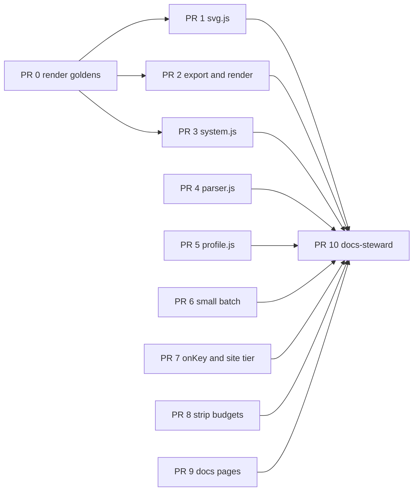

# Phase 3: Every Function Under Its Tier's CRAP Limit

> **For agentic workers:** REQUIRED SUB-SKILL: Use superpowers:subagent-driven-development (recommended) or superpowers:executing-plans to implement this plan task-by-task. Steps use checkbox (`- [ ]`) syntax for tracking.
> Nothing in this plan runs until Brandon approves it.

**Goal:** Bring every remaining function in `lib/` under its tier's CRAP limit, plus `onKey` in `site/app/editor.js`, then close the phase 2 follow-ups and refresh `.documentation/project.json`.

**Architecture:** Renderer output is pinned byte for byte first, because the phase 2 goldens cover return values but never SVG, Mermaid or DOT text.
Then each file group is split into pure, single-purpose pieces in the file it already lives in, one PR per file group.
Uncovered branches are either reached by a new test or removed once the plan shows they cannot run.

**Tech Stack:** Plain CommonJS in `lib/`, Node's built-in test runner, `scripts/measure.js`, `scripts/bench.js`, ESLint 9 through `npx` (no new dependency).

**Source of the targets:** `node scripts/measure.js` on `main` at e963409 (2026-11-24), the method from PRs #44 and #47.

## Global Constraints

The phase 2 constraints carry over unchanged:

- No PR changes what `parse`, `check`, `render`, `linkMap` or `sourceRanges` return for any model, except where a step names the change and Brandon approves it.
- `lib/` stays pure: no file system or network access, no new runtime dependency.
- Splits follow the shared architecture policy: each piece is a pure decider (model or evidence in, findings, boxes or text out), grouped by the rule or diagram it serves, with no new layer, class, registry or file unless a step says so.
- A shared helper is extracted only when two pieces already need it.
- Every new or changed function carries a budget block (PERFORMANCE-STANDARDS.md, "Annotation format").
  Values in this plan are **targets**; a block says "measured" only for a number `scripts/measure.js` produced in that PR.
- Every PR that touches `lib/` runs `node scripts/build-site.js` and commits the rebuilt bundle; files that differ only in line endings are restored, not committed.
- Every PR that touches a P0 function puts `node scripts/bench.js` tables from before and after (three runs each) in its description, and `node scripts/measure.js` output for the touched files before and after.
- Every PR keeps `npm test` green, and the phase 2 guarantee tests and the PR 0 render goldens pass unchanged unless a step says they change.
- An uncovered fallback such as `x || []` is removed only when the PR shows every producer of `x` sets it; otherwise it gets a test through the public API.

## How each number is measured

| Value | Command |
|---|---|
| CC, branch coverage and CRAP per function | `node scripts/measure.js [paths] --all` |
| Uncovered blocks inside one function | `NODE_V8_COVERAGE=<dir> node --test test/**/*.test.js`, then the zero-count ranges inside the function's lines |
| Time | `node scripts/bench.js`, three runs, quoted as a range |

The "after" CC values in this plan were estimated by reading the code, not measured on sketches as in phase 2.
If a real piece lands over 8, it splits again along line boundaries before the PR opens.

A function is **over** when its CRAP is strictly above its tier limit (P0 10, P1 15, P2 25).
CRAP is CC² × (1 − cov)³ + CC, so at 100% coverage CRAP equals CC and only a split brings it down.

## What is left (measured on e963409)

`node scripts/measure.js` (`lib` and `scripts`) lists 119 functions over some tier limit (CC, coverage or CRAP).
Of those, **22 are over the CRAP limit**, all P0; no P1 or P2 function is over.
The phase 2 plan's "other 36 functions over their CRAP threshold" came from PR #44's 41-row table; phase 2 (PRs #46 to #60) fixed 19 of the 41, and `lib/commands/` now has none left.

| # | Function | File | CC | Branch cov | CRAP |
|---|---|---|---|---|---|
| 1 | `unsourcedEventFields` | `lib/rules/profile.js:173` | 28 | 75% | 40.3 |
| 2 | `renderBoard` | `lib/diagram/svg.js:165` | 29 | 92% | 29.4 |
| 3 | `shape` | `lib/diagram/svg.js:47` | 26 | 100% | 26.0 |
| 4 | `renderGraph` | `lib/diagram/svg.js:344` | 18 | 73% | 24.1 |
| 5 | `toMermaid` | `lib/diagram/export.js:34` | 19 | 79% | 22.4 |
| 6 | `hotspotIssues` | `lib/rules/profile.js:382` | 21 | 92% | 21.2 |
| 7 | `containers` | `lib/diagram/system.js:156` | 20 | 100% | 20.0 |
| 8 | `balanced` | `lib/parser.js:116` | 19 | 86% | 19.9 |
| 9 | `accepted` | `lib/rules/index.js:77` | 16 | 78% | 18.8 |
| 10 | `commandGroups` | `lib/diagram/board.js:56` | 10 | 56% | 18.8 |
| 11 | `dataflow` | `lib/diagram/system.js:214` | 18 | 100% | 18.0 |
| 12 | `splitTop` | `lib/parser.js:162` | 18 | 100% | 18.0 |
| 13 | `check` callback in `scenarioStepIssues` | `lib/rules/profile.js:119` | 17 | 96% | 17.0 |
| 14 | `finalize` | `lib/model.js:32` | 16 | 100% | 16.0 |
| 15 | `toDot` | `lib/diagram/export.js:71` | 12 | 71% | 15.4 |
| 16 | `parsePolicy` | `lib/parser.js:416` | 15 | 100% | 15.0 |
| 17 | `parseFact` | `lib/parser.js:263` | 13 | 79% | 14.7 |
| 18 | `render` | `lib/diagram/index.js:33` | 13 | 95% | 13.0 |
| 19 | step callback in `parseSteps` | `lib/parser.js:483` | 11 | 82% | 11.7 |
| 20 | `parseScenario` | `lib/parser.js:507` | 11 | 91% | 11.1 |
| 21 | `resolve` in `linkMap` | `lib/diagram/links.js:278` | 11 | 100% | 11.0 |
| 22 | `enrich` | `lib/rules/index.js:45` | 11 | 94% | 11.0 |

Near the CC 30 ceiling: `renderBoard` 29, `unsourcedEventFields` 28, `shape` 26.

At the limit and out of scope (CRAP exactly 10.0 at P0, or 15.0 at P1): `layering`, `linkMap`, the profile callback at `lib/rules/profile.js:284`, `hints`, `acceptIssues`, and `run` in `lib/commands/deps.js`.

### Browser code

`onKey` in `site/app/editor.js:146` is CC 22 at 100% coverage, so CRAP 22.
`scripts/measure.js` puts every `site/` file at P2 (limit 25), where it passes; PR #44's table holds browser code to P0 (limit 10).
See Open question 1.
If `site/` is P0, 13 more browser functions are over 10 (`drawBoard` 22, the `app.js` wrapper 19, `onType` 16.6, `mount` 16, `nodeAtCaret` 16, `paintTimer` 14, `help` 13, `showReview` 13, `show` 13, `hlLine` 13, `focusIssue` 12, `applyHash` 12, `matchBracket` 11), and the ones in `site/playground.js` and `site/app/app.js` have no measured coverage: `test/playground.test.js` runs the playground through `node:vm`, and no test loads `app.js`.

### Measurement gaps found

- `scripts/measure.js` parses every file as CommonJS, so it crashes on `docs-site/scripts/*.mjs`; fixed in PR 8.
- `bin/` has no function over any limit.

## Baseline (main at e963409, three bench runs, Node 22 on WSL2)

| Scale | parse ms | check ms | board ms | loop ms |
|---|---|---|---|---|
| 1x (2.7 kB) | 0.89 to 0.91 | 0.52 to 0.57 | 0.95 to 1.11 | 0.71 to 0.87 |
| 10x (27 kB) | 1.91 to 2.69 | 2.10 to 2.44 | 10.35 to 11.13 | 9.76 to 11.69 |
| 50x (135 kB) | 8.41 to 12.31 | 8.91 to 10.14 | 121 to 150 | 128 to 168 |
| 50x with `@link` | 5.84 to 7.49 | 22 to 40 | 123 to 190 | 142 to 182 |
| 50x with `@link` to the board | 6.84 to 9.08 | 131 to 185 | 132 to 224 | 140 to 158 |

`site/eventline.js`: 172.9 kB raw, 48.6 kB gzip.
None of this phase's targets is on a superlinear path that the bench shows; the Big-O fixes below are small and are listed so the PRs do not make them worse.

## Targets at a glance

| PR | File group | Targets | After (target) |
|---|---|---|---|
| 0 | tests only | render goldens, no source change | n/a |
| 1 | `lib/diagram/svg.js` | `renderBoard`, `shape`, `renderGraph` | coordinators CC 3 or less, pieces CC 7 or less |
| 2 | `lib/diagram/export.js`, `lib/diagram/index.js` | `toMermaid`, `toDot`, `render` | pieces CC 5 or less |
| 3 | `lib/diagram/system.js` | `containers`, `dataflow` | coordinators CC 2, pieces CC 6 or less |
| 4 | `lib/parser.js` | `balanced`, `splitTop`, `parsePolicy`, `parseFact`, step callback, `parseScenario` | pieces CC 7 or less |
| 5 | `lib/rules/profile.js` | `unsourcedEventFields`, `hotspotIssues`, `check` callback | pieces CC 7 or less |
| 6 | `lib/rules/index.js`, `lib/model.js`, `lib/diagram/links.js`, `lib/diagram/board.js` | `accepted`, `enrich`, `finalize`, `resolve`, `commandGroups` | pieces CC 7 or less |
| 7 | `site/app/editor.js`, `scripts/measure.js` | `onKey`, and the `site/` tier | `onKey` CC 6 or less |
| 8 | `scripts/`, `.github/workflows/` | strip budget blocks from served files; measure `.mjs` | about 16 kB less served |
| 9 | `docs-site/` | missing doc pages | n/a |
| 10 | `.documentation/` | docs-steward refresh | n/a |

With CC 8 and branch coverage 90%, CRAP is 8.06, so every piece below passes as long as its coverage stays at 90% or more.

---

## PR 0: Render goldens (test only, no source change)

The phase 2 goldens pin return values and deliberately leave out SVG text.
PRs 1 to 3 change functions that return strings, so their output must be pinned byte for byte first.

**Files:** extend `test/guarantee.test.js`; create `test/fixtures/guarantee/render.json`.

- [ ] **Step 1:** For every `examples/*.dsl` and the phase 2 link fixture, render every kind in `KINDS` as `svg` (light and dark), `mermaid` and `dot`, with and without `{ links: true }`.
  Store a SHA-256 of each output in `render.json`, keyed `<model>/<kind>/<format>/<theme>/<links>`, and the error code where a kind cannot draw (`NO_REGIONS`, `NO_CONTEXTS`).
- [ ] **Step 2:** On a mismatch the test writes the actual output to `os.tmpdir()` and names the file, so a reviewer can diff it.
- [ ] **Step 3:** Regenerate only with `UPDATE_GOLDENS=1`, as in phase 2.
- [ ] **Step 4:** `npm test` green; record the new test count in the PR.

**Risk:** low; hashes keep the fixture small (about 400 entries), at the cost of needing the dump in Step 2 to see a diff.
**Estimate:** p50 25 min, p90 50 min.
Main risk: a render that differs between runs (none known; the test fails fast if so).

## PR 1: Split the SVG renderers

**Files:** `lib/diagram/svg.js`, tests in `test/diagram.test.js`.

`shape` becomes a lookup of one body function per node kind, with the dashed and accent decisions pulled out.
`renderBoard` and `renderGraph` become coordinators over geometry, groups, edges, nodes and the legend.
Both draw a dashed box around a group's members; that bounding box is the one shared helper, since two pieces need it today.

| Piece | Lines today | CC (target) |
|---|---|---|
| `shape` | 47 to 86 | 3 |
| `isDashed(n)` | 49 | 6 |
| `onAccent(n)` | 50 | 3 |
| `nodeText(n, g, t, accent)` (label and sub) | 51 to 52 | 4 |
| `BODIES`: one function per kind (`event`, `command`/`process`, `view`/`store`/`cache`, `policy`/`worker`, `timer`, `external`, `system`), `actor` as default | 54 to 84 | 1 or 2 each |
| `renderBoard` | 165 to 265 | 2 |
| `boardEdges(board, geo, t)` (the edge loop and its `bump` counter) | 217 to 238 | 3 |
| `boardGeometry(board)` (column widths, lane tops, box geometry, width, height) | 166 to 193 | 7 |
| `laneBands(...)` | 197 to 201 | 2 |
| `bounds(boxes, padX, padTop, padBottom)` (shared with `renderGraph`) | 207 to 210, 384 to 387 | 1 |
| `boardGroups(...)` | 203 to 215 | 4 |
| `boardEdge(e, a, b, back, bump, t)` with `treeEdge` and `readsEdge` | 222 to 236 | 3, 1, 2 |
| `boardNode(n, g, opts, t)` (tooltip, ranges, notes) | 239 to 245 | 6 |
| `legend(board, t, x, y)` with a `LEGEND` table of sample nodes | 247 to 259 | 3 |
| `boardDesc(board)` (counts and plurals) | 261 to 263 | 2 |
| `renderGraph` | 344 to 409 | 3 |
| `stackLayout(graph)` and `flatLayout(graph)` | 356 to 373 | 3 and 1 |
| `graphGroups(...)` | 381 to 392 | 3 |
| `graphEdges(...)` (the edge loop and its `bump` counter) | 394 to 399 | 4 |
| `graphSize(...)` | 406 to 407 | 3 |

**Coverage gaps** (uncovered blocks today), each checked against what the builders produce:
- unknown theme falls back to light (`renderBoard` and `renderGraph`): reachable through `render(model, kind, 'svg', 'sepia')`; test.
- a board group with a `sub`: reachable, `boundaryGroups` sets it from `shardNote` for a partitioned boundary; test.
- a node with `fullNotes`: reachable, `buildBoard` sets it from `@note` on a command, read model or policy; test.
- `e.kind === 'given'` (line 235): no builder makes a `given` edge, and `reads` edges take the branch above, so the style is always solid; remove.
- a board group with no drawn member (line 205): every group holds its own command box; test or remove, and the PR says which.
- an edge whose end is not drawn (`renderGraph` line 396): reachable; `twitter-pure.dsl` plus `from [Ghost] -> sweeper -> sweep()` renders `containers` as svg, mermaid and dot without error and drops the edge from `view:Ghost` (checked 2026-11-24); test.
- `renderGraph` with no subtitle and with no groups: test or remove.

**Guards:** PR 0 render goldens, `test/site.test.js` (homepage board equals `render`), `test/diagram.test.js` ("every kind and format renders").
**Risk:** medium; string concatenation order is the output, and the goldens catch any slip.
**Estimate:** p50 60 min, p90 120 min.
Main risk: the `bump` counter for back edges grows across edges, so it lives in `boardEdges` and `graphEdges`, never in the per-edge piece.

## PR 2: Split the text exports and `render`

**Files:** `lib/diagram/export.js`, `lib/diagram/index.js`.

`toMermaid` and `toDot` both declare ungrouped nodes, then each group with its members, then the drawn edges.
That walk is the shared helper: `nodeBlocks(graph)` returns the loose nodes and each group's member nodes, using a node map instead of `graph.nodes.find` per member (O(G·N) to O(N)).

| Piece | CC (target) |
|---|---|
| `nodeBlocks(graph)` (shared) | 3 |
| `drawnEdges(graph, id)` (shared) | 2 |
| `toMermaid` | 3 |
| `mermaidNode`, `mermaidEdge`, `mermaidClicks`, `mermaidClasses` | 2, 3, 4, 4 |
| `toDot` | 3 |
| `dotNode`, `dotEdge` | 5, 4 |
| `render` | 4 |
| `svgOf(model, kind, diagram, theme, links)` | 3 |
| `textOf(kind, diagram, format, links)` | 3 |

**Fallbacks to remove:** `graph.direction || 'LR'` and `graph.groups || []` in both exports.
`toMermaid` and `toDot` are not exported from `lib/index.js`; their only caller is `render`, and every builder (`context`, `containers`, `dataflow`, `deployment`, `contextMap`, `boardToGraph`) sets both fields.
The PR quotes those six return statements as the proof.

**Coverage gaps to close with tests:** an unknown kind and an unknown format in `render` (both throw), and an edge to an undrawn node in each export (same model as PR 1).

**Guards:** PR 0 goldens for `mermaid` and `dot`, `test/links.test.js` (click and URL lines), `test/cli.test.js`.
**Risk:** low.
**Estimate:** p50 35 min, p90 70 min.
Main risk: none beyond keeping `classDef` order (first appearance of each kind).

## PR 3: Split the system diagrams

**Files:** `lib/diagram/system.js`.

Both functions are at 100% coverage, so only a split lowers CRAP.
Each loop becomes a pure function that returns its nodes and edges; the coordinator concatenates them in today's order.

| Piece | Lines today | CC (target) |
|---|---|---|
| `containers` | 156 to 201 | 2 |
| `actorContainers(actors)` | 164 to 167 | 3 |
| `coreContainers(model, keys)` (API and store) | 168 to 172 | 4 |
| `viewContainers(model, readByCommand)` | 174 to 181 | 4 |
| `workerContainers(model)` | 182 to 190 | 6 |
| `externalContainers(externals)` | 191 to 198 | 2 |
| `systemLabel(model)` | 199 | 3 |
| `dataflow` | 214 to 254 | 2 |
| `commandFlows(model, actors, externals, seen)` with `issuer(model, cmd, actors, externals)` | 224 to 235 | 5 and 3 |
| `viewFlows(model)` | 236 to 239 | 1 |
| `workerFlows(model, seen)` | 240 to 249 | 6 |
| `connectedOnly(nodes, edges)` | 250 to 252 | 1 |

`seen` is shared between commands and workers, so it stays one `Set` created by `dataflow` and passed to both, in today's order.

**Big-O fixed here:** `containers` runs `model.commands.some(cmd.from.some(...))` per read model, O(v·c·f).
Build the set of read model names any command reads once: O(c·f + v).

**Guards:** PR 0 goldens, phase 2 diagram goldens (`containers` and `dataflow` node and edge order), `test/diagram.test.js`.
**Risk:** low.
**Estimate:** p50 35 min, p90 70 min.
Main risk: node order when a worker adds a command that is "not modeled".

## PR 4: Split the parser helpers

**Files:** `lib/parser.js`, `test/parser.test.js`.

`balanced` and `splitTop` both skip over quoted strings and count bracket depth; those two scans are the shared helpers.

| Piece | Lines today | CC (target) |
|---|---|---|
| `stringEnd(s, i)` (index after the closing quote, honoring backslash) | 128 to 129, 169 to 171 | 3 |
| `depthStep(ch)` (+1, −1 or 0) | 138 to 139, 173 to 174 | 4 |
| `balanced` | 116 to 147 | 6 |
| `atComment(s, i)` | 134 | 3 |
| `splitTop` | 162 to 181 | 6 |
| `parsePolicy` | 416 to 445 | 5 |
| `triggerPayload(sc, trigger)` | 417 | 3 |
| `parseRule(sc)` (guard or arrow, then emissions or worker and command) | 422 to 439 | 7 |
| `policyWhat(trigger)` | 441 | 3 |
| `parseFact` | 263 to 277 | 6 |
| `freshnessOf(ann)` | 271 to 272 | 5 |
| step callback | 483 to 503 | 4 |
| `STEPS.when`, `STEPS.given`, `STEPS.then` | 491 to 502 | 4, 2, 3 |
| `parseScenario` | 507 to 531 | 4 |
| `readBlock(sc, name, line)` | 515 to 524 | 4 |
| `trimBlank(lines)` and `dedent(lines)` | 525 to 527, 529 | 3 and 3 |

**Behavior trap:** `splitTop` today treats an unclosed quote as running to the end of the text, and a backslash only inside a string.
`stringEnd` must return the text length for an unclosed string so `splitTop` keeps that.
Step 1 of the PR adds a table test for both functions before the split: nested brackets, escaped quotes, an unclosed quote, a `//` comment after `(`, `{`, `[`, `,` or a space, and a `//` inside a word.

**Coverage gaps to close with tests:** `balanced` with no opening bracket and with a comment at offset 0; `parseFact` with `@strong`, bare `@fresh` and trailing text; a scenario with blank lines between steps, `when` without arguments, two `then` steps; a scenario with leading and trailing blank lines and an all-blank body.

**Guards:** phase 2 parser goldens (`forms.dsl`, `parse-errors.json`), every example parsing to its golden model, `test/syntax.test.js`.
**Risk:** medium; `balanced` is the parser's hot inner loop and its cursor must land exactly where it does today.
Bench before and after; `balanced` builds its output one character at a time today, and slicing between strings may make it faster, which the bench shows either way.
**Estimate:** p50 60 min, p90 120 min.
Main risk: cursor position after an unclosed string or a comment.

## PR 5: Split the profile rules

**Files:** `lib/rules/profile.js`.

`unsourcedEventFields` checks commands and policies with the same steps: collect what is supplied, then report each emitted field not in it.

| Piece | Lines today | CC (target) |
|---|---|---|
| `unsourcedEventFields` | 173 to 208 | 2 |
| `unknownSource(model, shape, facts)` | 180 | 4 |
| `addFacts(supplied, facts, fieldsOf)` (args, alias, then what the fact carries; shared by both halves) | 185 to 186, 198 | 3 |
| `commandSupplies(cmd, known, shape)` | 184 to 186 | 2 |
| `policySupplies(pol, shape)` | 197 to 198 | 1 |
| `unsourced(emits, supplied)` | 189, 202 | 2 |
| `itThem(n)` | 190, 203 | 2 |
| `commandFindings(cmd, ...)` | 187 to 192 | 4 |
| `policyFindings(pol, ...)` with `policyWho(pol)` | 195 to 205 | 5 and 3 |
| `hotspotIssues` | 382 to 394 | 5 |
| `hotspotProblem(q, o)` (an ordered list of test and message pairs, first hit wins) | 388 | 7 |
| `check` callback | 119 to 140 | 4 |
| `stepShape(sc, owner)` (no when, wrong when, no then) | 124 to 126 | 5 |
| `givenFindings(sc, known)` | 128 | 3 |
| `thenFindings(sc, owner, outcomes)` | 129 to 138 | 6 |

**Fallback to remove:** `pol.trigger.fields || []`.
Every policy trigger is built in `lib/parser.js` with `fields: []` (`eventPolicy`, `timer`, `parseFromAutomation`); the PR quotes the three.
`shape.get(f.name) || []` stays: a `from` list may name an event, which has no shape.

**Coverage gaps to close with tests:** a command fact with an alias; a policy that reads a declared read model through an alias (the `from` loop at line 198); a policy whose `from` source is unknown; two missing fields ("them"); a hotspot with a bad status and one with `concerns` on a question; scenario steps on a read model.

**Big-O fixed here:** the `check` callback filters every command per scenario.
Build a map from actor and command name to its emitted events and rejections once per call: O(c·β + s) instead of O(s·c·β).

**Guards:** phase 2 check goldens across all examples and profiles, `test/rules.test.js` ("every example in the catalogue behaves as it says").
**Risk:** low-medium; finding order within one command or policy is the trap, and the goldens pin it.
**Estimate:** p50 50 min, p90 100 min.
Main risk: the order of the "them" and "it" wording when only one field is missing.

## PR 6: The small ones (four files, one PR)

**Files:** `lib/rules/index.js`, `lib/model.js`, `lib/diagram/links.js`, `lib/diagram/board.js`.

| Target | Split | CC (target) |
|---|---|---|
| `accepted` | `acceptMarks(model)`, `markAccepted(issues, marks)`, `unusedAccept(line, a, list)` | 2, 6, 4, 5 |
| `enrich` | `subjectAt(list, line)`, `severityOf(meta, found, profile)` | 5, 4, 3 |
| `finalize` | `recordCommand`, `recordView`, `recordPolicy`, `recordDeclaration`, each given the `ev` and `emitted` closures | 1, 4, 2, 6, 3 |
| `resolve` | `deadTarget(inv, from, fromId, t)` | 3, 5 |
| `commandGroups` | `newGroup(cmd)`, and the fallbacks removed | 6, 1 |

**`commandGroups` fallbacks:** `cmd.notes || []`, `cmd.triggers || []` and `cmd.annotations || {}` cannot run.
`parseCommand` (`lib/parser.js:375` to `385`) always sets all three, `triggersFrom` always returns an array, and the only caller is `buildBoard` on a parsed model.
They are removed.
`if (!g.boundary && cmd.boundary) g.boundary = cmd.boundary` is reachable: two commands with the same actor and name where only the later one is `in Boundary(key)`.
It gets a test.

**`enrich` Big-O:** it filters and sorts the statement list per finding, O(f·S log S).
`subjectAt` keeps the first statement with the smallest span in one scan, O(f·S), which matches the stable sort's choice on ties.

**Coverage gaps to close with tests:** an unknown rule in `enrich` (throws); an unused `@accept` on a statement the statement list does not hold (the `s` is missing branch), or proof that none exists, in which case the branch is removed.

**Guards:** phase 2 check, board and `linkMap` goldens, `test/rules.test.js`, `test/links.test.js`.
**Risk:** low.
**Estimate:** p50 45 min, p90 90 min.
Main risk: `finalize` field-length tie-breaks, where the first event to carry the longest field list wins.

## PR 7: `onKey` and the tier of `site/`

**Files:** `site/app/editor.js`, `scripts/measure.js`, `PERFORMANCE-STANDARDS.md`, `test/app-editor.test.js`.

- [ ] **Step 1:** Set the tier of `site/` in `tierOf` and in the CRAP table of PERFORMANCE-STANDARDS.md, per Open question 1.
- [ ] **Step 2:** Split `onKey`.

| Piece | Lines today | CC (target) |
|---|---|---|
| `onKey` (IME guard, Ctrl+Space, then one of the two below) | 146 to 162 | 5 |
| `isCtrlSpace(ev)` | 148 | 4 |
| `onListKey(ev)` (a completion list is open: down, up, accept, close) | 149 to 155 | 7 |
| `plainKey(ev)` (no Shift, Ctrl, Alt or Meta) | 152 | 4 |
| `onEditorKey(ev)` (no list: Shift, Esc then Tab, then `help`) | 156 to 161 | 6 |
`app-editor.test.js` already covers `onKey` at 100% (PR #46) and must stay at 90% or more.

**Guards:** `test/app-editor.test.js`, `test/app-editing.test.js`, the a11y check in CI.
**Risk:** low.
**Estimate:** p50 25 min, p90 50 min.
Main risk: Esc then Tab timing (`escAt`), which moves into `onEditorKey` unchanged.

## PR 8: Strip budget blocks from served files, and measure `.mjs`

**Files:** `scripts/strip-budgets.js` (new), `scripts/build-site.js`, `scripts/measure.js`, `.github/workflows/ci.yml`, `.github/workflows/pages.yml`.

`site/playground.js` and `site/app/*.js` are served as written and carry 33 budget blocks, 15.8 kB raw.
`build-site.js` already strips them from `site/eventline.js` with `PERF_BLOCK`.

- [ ] **Step 1:** Move `PERF_BLOCK` into `scripts/strip-budgets.js`, which exports it for `build-site.js` and, run as `node scripts/strip-budgets.js <dir>`, strips every `.js` file under a folder in place.
- [ ] **Step 2:** In both `ci.yml` and `pages.yml`, run it on the output folder right after `cp -r site/. <out>/`, so the disclosure scan in CI reads exactly what Pages serves.
- [ ] **Step 3:** Test: strip a copy of `site/`, assert no `# Performance & Risk Budget` remains and every stripped file passes `node --check`.
- [ ] **Step 4:** In `scripts/measure.js`, give `.mjs` files `sourceType: 'module'`, so `node scripts/measure.js docs-site/scripts` works; add a case to `test/measure.test.js`.

The source files keep their blocks; only the served copy loses them.

**Risk:** low.
**Estimate:** p50 25 min, p90 50 min.
Main risk: a workflow step that runs before the copy; the CI test in Step 3 runs on the same folder layout.

## PR 9: Missing docs site pages

**Files:** `docs-site/scripts/sync-docs.mjs`, `docs-site/astro.config.mjs`, `test/docs-site.test.js`.

- [ ] **Step 1:** Add `AGENTS.md` and `PERFORMANCE-STANDARDS.md` to `PAGES`, and to the "Build with it" sidebar group with `architecture` and `contributing`.
- [ ] **Step 2:** `docs/superpowers/` per Open question 3.
- [ ] **Step 3:** Extend the "every doc has a page" test to these files.

**Risk:** low; check that links inside the new pages rewrite to routes or GitHub links (`rewriteLink`).
**Estimate:** p50 20 min, p90 45 min.
Main risk: links from `AGENTS.md` to files outside `docs/`.

## PR 10: docs-steward refresh (last)

**Files:** `.documentation/project.json` (and `.documentation/operation.json` if the runtime writes it).

- [ ] **Step 1:** Run docs-steward through its runtime, not by hand.
  `rtk reactive-skills-axi bootloader docs-steward --json` answered on 2026-11-24 (runtime 0.22.0).
  Then, per the skill's README, `rtk reactive-skills-axi invoke <absolute docs-steward skill folder> --job phase3-docs`, choose maintain mode and the repo root when the runtime asks, and `emit` each signal it asks for.
- [ ] **Step 2:** Stop at its APPROVE gate and hand the revision-bound file plan to Brandon; nothing is written before he approves.
- [ ] **Step 3:** After approval, commit only what the runtime wrote, and open the PR.

It goes last so the inventory covers every doc changed by PRs 7 to 9 and this plan.

**Risk:** low.
**Estimate:** p50 20 min, p90 60 min agent time, plus one wait on Brandon at the gate.
Main risk: the runtime asking for inputs this plan did not foresee.

---

## Order and dependencies

PRs 1 to 3 need PR 0; PRs 4 to 9 touch different files and need nothing but `main`.
Every PR from 1 to 6 commits the rebuilt `site/eventline.js`, so they merge one at a time and each later one rebases and reruns `node scripts/build-site.js`.
PR 1 and PR 2 both rely on the "edge to an undrawn node" model; PR 1 adds it and PR 2 reuses it.
PR 10 goes last.

## Estimates

Agent wall-clock to PR-ready, including bench runs, budget blocks, `build-site.js` and `npm test`.
These are judgment-based, scaled from the phase 2 PRs of similar size (#54 `derive`, 241 lines added, and #55 `check`, 346 lines added); the `estimate` skill and its historical data were not consulted.

| PR | p50 | p90 | Main risk |
|---|---|---|---|
| 0 Render goldens | 25 min | 50 min | nondeterministic output |
| 1 `svg.js` | 60 min | 120 min | back-edge `bump` order |
| 2 Exports and `render` | 35 min | 70 min | `classDef` order |
| 3 `system.js` | 35 min | 70 min | node order for unmodeled commands |
| 4 `parser.js` | 60 min | 120 min | cursor after an unclosed string |
| 5 `profile.js` | 50 min | 100 min | finding order |
| 6 Small batch | 45 min | 90 min | `finalize` ties |
| 7 `onKey` and tier | 25 min | 50 min | Esc then Tab |
| 8 Strip budgets | 25 min | 50 min | workflow step order |
| 9 Docs pages | 20 min | 45 min | link rewriting |
| 10 docs-steward | 20 min | 60 min | runtime inputs |
| Total, in order | about 6.7 h | about 13.8 h | `svg.js` and `parser.js` |

CI is about 30 s per PR, plus the docs site build.
Token cost is roughly 100k to 250k per PR, and 300k to 500k for PRs 1 and 4.

**Owner touch-points:** approve this plan and answer the open questions (1, can be one reply), merge each PR (11), approve the docs-steward file plan (1).
Work waits on Brandon about 13 times; merging PRs 4 to 9 as one review batch cuts that to about 8.

## Open questions for Brandon

1. **Tier of `site/`.** `scripts/measure.js` puts `site/` at P2 (limit 25), so `onKey` passes today; PR #44's table holds it to P0 (limit 10).
   Recommendation: P0 for `site/app/` and `site/playground.js`, since they run on every keystroke, set in PR 7.
   That makes 13 more browser functions over the limit; recommendation: a phase 4 plan for them, because `site/playground.js` and `site/app/app.js` first need coverage that survives `node:vm`.
2. **Render goldens as hashes.** Hashes keep the fixture small but hide the diff until the test dumps it; full text is reviewable in the PR but adds about 400 files.
   Recommendation: hashes with the dump.
3. **`docs/superpowers/` on the docs site.** The plans and specs are already public in the repo, but they are working documents.
   Options: every plan and spec as its own page, one index page linking to them on GitHub, or leave them off the site.
   Recommendation: one index page linking to GitHub.
4. **Budget blocks in served files.** Strip them in the copy step (PR 8, source keeps them) or move them out of the browser files.
   Recommendation: strip in the copy step.
5. **A CRAP gate.** Once PRs 1 to 7 land, add a `--max-crap` check to CI next to the CC 30 guard, failing any function over its tier limit.
   Not in this plan unless approved; it would be PR 11.
6. **Open issues on the same files.** #63 (branch guards), #64 (refusal guards in board exports) and #67 (boundary labels) change `board.js`, `export.js` or `svg.js` output, which PRs 0 to 2 and 6 pin and split.
   Recommendation: land this phase's PRs on those files first, so each issue fix is a small diff against pinned output; an issue fix that lands first regenerates the PR 0 goldens and says why.

## Out of scope

The at-limit functions listed above, the 13 browser functions in Open question 1, and any function whose CC is over its tier's CC target but whose CRAP passes.
